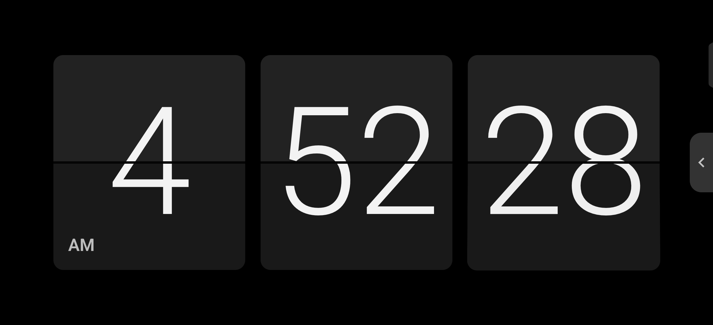
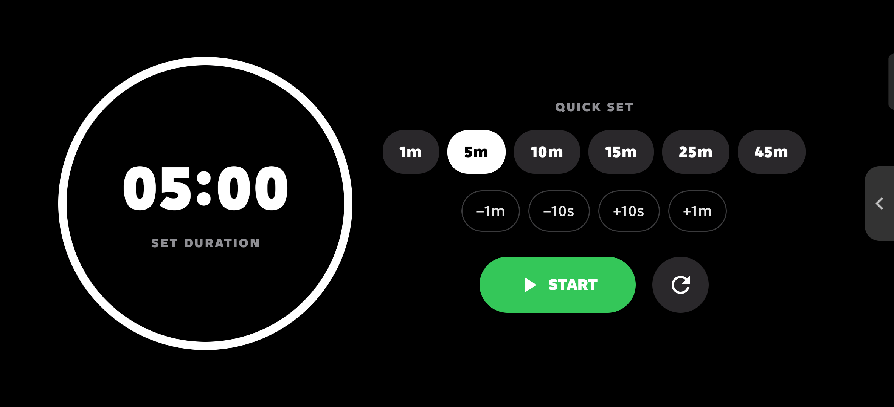
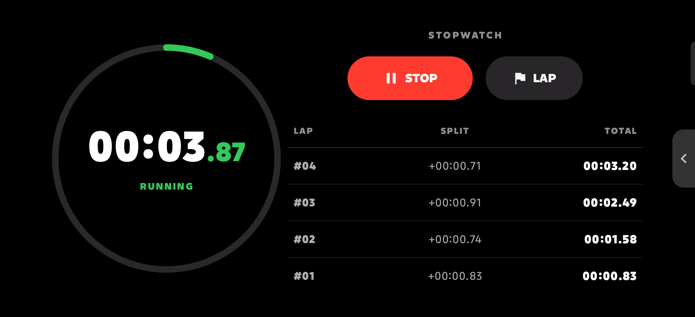
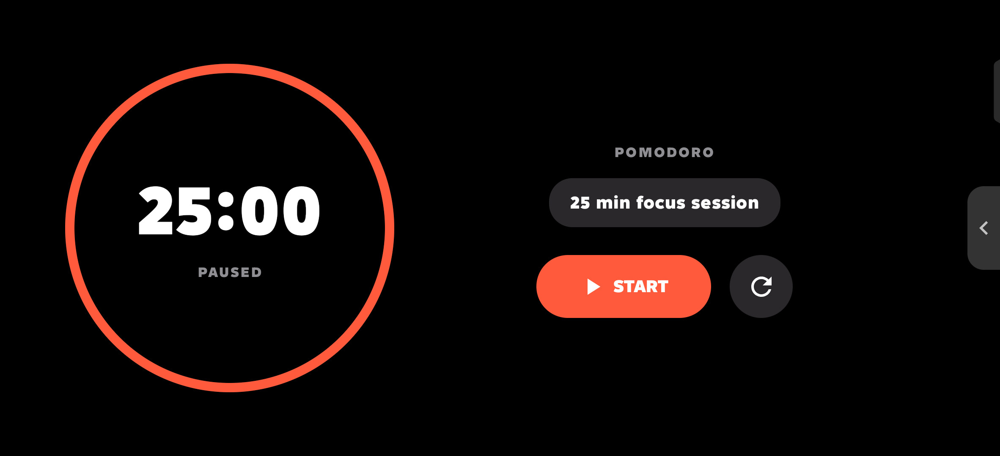
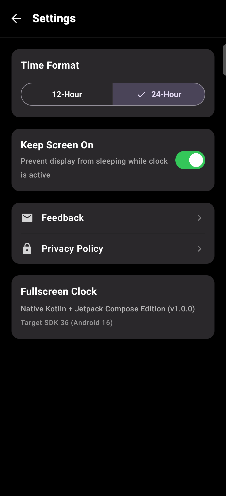

<div align="center">

# ⏱️ Study Clock — Fullscreen OLED Desk Clock & Productivity Suite

[](https://kotlinlang.org)
[](https://developer.android.com/jetpack/compose)
[](https://m3.material.io/)
[](https://developer.android.com)
[](LICENSE)

**A distraction-free, true-black OLED desk clock, 3D mechanical split-flap clock, Pomodoro focus timer, precision stopwatch, and countdown timer built with Kotlin & Jetpack Compose.**

[Screen Gallery](#-live-device-screenshots) • [Key Features](#-key-features) • [Architecture](#-tech-stack--architecture) • [Build & Install](#-getting-started)

</div>

---

## 📸 Live Device Screenshots

All screenshots below are captured directly from a physical Android device (`2400 × 1080` Landscape / Portrait) running **Study Clock**.

### 1. Digital Desk Clock & Unified Mode Drawer
| Pure Fullscreen Digital Clock | Top Format Toggles & 6-Card OLED Mode Dock |
| :---: | :---: |
|  |  |
| *Distraction-free true `#000000` OLED display* | *Instant `12H/24H` & `Sec Off/On` toggles + 6 custom OLED vector mode cards* |

| 12-Hour Mode with Seconds (`HH:MM:SS`) | 24-Hour Mode with Seconds (`HH:MM` + `:ss`) |
| :---: | :---: |
|  |  |
| *Full 6-digit display with bottom-aligned `AM/PM` badge* | *Primary `HH:MM` display with subordinate seconds counter* |

---

### 2. Retro 3D Split-Flap Clock (`HH:MM` & `HH:MM:SS`)
| Classic 2-Card Flip Clock (`Sec Off`) | 3-Card Split-Flap Clock with Live Seconds (`Sec On`) |
| :---: | :---: |
|  |  |
| *Two-tone charcoal flaps (`#222222` / `#191919`) with `#050505` center seam* | *3D perspective `rotationX` split-flap animation ticking every second* |

---

### 3. Dark OLED Productivity Suite (Timer, Stopwatch & Pomodoro)
| Countdown Timer (Quick Presets & Clockwise Ring) | Precision Stopwatch (60s Dial & Live Laps Table) |
| :---: | :---: |
|  |  |
| *Clockwise right-first depleting ring (`Green → Amber → Red`), quick presets (`1m–45m`), fine-tune chips (`±1m`, `±10s`), and synthesized `Beep-Beep` digital alarm* | *60s sweeping progress ring, centisecond precision, and direct borderless lap table with automatic scroll-to-top on new laps* |

| Pomodoro Focus Timer (25-Min Sessions) | Material 3 Dark OLED Settings |
| :---: | :---: |
|  |  |
| *Tomato-red (`#FF5A3C`) circular progress dial & session tracker* | *Global time format, Keep Screen On switch & app info* |

---

## ✨ Key Features

### 🕰️ Minimalist Digital & Split-Flap Clocks
- **Zero-Flicker Format Switching:** Toggle between `12-Hour` / `24-Hour` and `Sec Off` / `Sec On` directly from the floating top bar without screen reloads or layout jumps.
- **System Font-Scale Immunity:** Custom `LocalDensity` typography calculations neutralize Android accessibility `fontScale` inflation so digits never clip or overflow on any screen.
- **Authentic 3D Flip Clock:** Real-time `0° → 90° → 180°` `graphicsLayer` perspective folding with dynamic shadow alpha, two-tone charcoal cards, and both 2-card (`HH:MM`) and 3-card (`HH:MM:SS`) modes.

### ⏲️ Smart Countdown Timer
- **Clockwise Right-First Depletion:** Custom `Canvas` arc depletes clockwise starting from 12 o'clock through 3, 6, and 9 o'clock.
- **Dynamic Color Progression:** Smoothly interpolates ring color via `lerp` from **Green (`#34C759`) → Amber (`#FFCC00`) → Orange → Red (`#FF3B30`)** as time runs out.
- **Quick Set & Fine-Tune Controls:** One-tap preset pills (`1m`, `5m`, `10m`, `15m`, `25m`, `45m`) plus seconds-level adjustment chips (`−1m`, `−10s`, `+10s`, `+1m`).
- **Synthesized Digital "Beep-Beep" Alarm:** Custom 44.1 kHz 16-bit PCM `AudioTrack` (`USAGE_ALARM`) synthesizer generates classic digital watch `BEEP-BEEP` bursts alongside `AlarmManager` notifications and haptics.

### ⏱️ Precision Stopwatch & Pomodoro
- **60-Second Sweeping Stopwatch Dial:** 60fps (`16ms` tick) stopwatch with green sweeping ring and jitter-free monospace typography.
- **Borderless Auto-Scrolling Lap Table:** Clean 3-column table (`LAP`, `SPLIT`, `TOTAL`) rendered directly on the OLED canvas that automatically scrolls to the newest lap (`#01, #02...`) at the top without shifting button positions.
- **Dark OLED Pomodoro Timer:** 25-minute focus sessions with tomato-red circular progress ring and completed session counter.

### 🎛️ Unified 6-Card Mode Dock & Gesture Controls
- **Consolidated 6-Card Bottom Drawer:** Centered landscape dock (`Digital Clock`, `Flip Clock`, `Pomodoro`, `Stopwatch`, `Timer`, `Settings`) with custom-drawn Dark OLED vector/canvas icons.
- **3-Second Smart Auto-Hide:** Tapping anywhere reveals the top toggle bar and bottom mode dock; 3 seconds of inactivity smoothly slides them away.

---

## 🛠️ Tech Stack & Architecture

| Layer | Technology |
| :--- | :--- |
| **Language** | Kotlin `2.0.21` |
| **UI Framework** | Jetpack Compose (`BOM 2024.11.00`) + Material 3 + Custom `Canvas` & `graphicsLayer` |
| **Architecture** | MVVM (`TimersViewModel`, unidirectional `StateFlow` state, `ClockPreferences`) |
| **Concurrency** | Kotlin Coroutines (`clockTickerFlow` aligned to wall-clock seconds, 60fps timer/stopwatch loops) |
| **Audio & Alarms** | PCM `AudioTrack` (`USAGE_ALARM`) waveform synthesis + `AlarmManager.setExactAndAllowWhileIdle()` |
| **Windowing** | Edge-to-Edge Immersive Sticky Fullscreen (`BEHAVIOR_SHOW_TRANSIENT_BARS_BY_SWIPE`) + `FLAG_KEEP_SCREEN_ON` |

---

## 📂 Project Structure

```text
study-clock/
├── app/src/main/
│   ├── AndroidManifest.xml
│   ├── java/com/ghost/fullscreenclock/
│   │   ├── MainActivity.kt                  # Edge-to-edge immersive fullscreen & keep-screen-on setup
│   │   ├── model/ClockMode.kt               # Clock & productivity mode definitions
│   │   ├── preferences/ClockPreferences.kt  # Persistent SharedPreferences wrapper
│   │   ├── receiver/TimerAlertReceiver.kt   # BroadcastReceiver + PCM digital beep-beep synthesizer
│   │   ├── theme/                           # PureBlack OLED palette, Roboto typography & Material 3 theme
│   │   ├── time/ClockTicker.kt              # Wall-clock synchronized second ticker Flow
│   │   └── ui/
│   │       ├── ClockApp.kt                  # Root state host, orientation manager & drawer orchestration
│   │       ├── components/
│   │       │   ├── BottomModeDrawer.kt      # 6-card centered dock with custom OLED vector/canvas icons
│   │       │   ├── DigitalClock.kt          # Cap-height calibrated responsive digital clock renderer
│   │       │   ├── FlipCard.kt              # 3D split-flap card component with perspective shadow
│   │       │   └── SideDrawerHandle.kt      # Edge pull handle for quick mode switching
│   │       ├── screens/
│   │       │   ├── DigitalClockScreen.kt    # Digital clock + floating 12H/24H & Sec Off/On control bar
│   │       │   ├── FlipClockScreen.kt       # 2-card (HH:MM) & 3-card (HH:MM:SS) split-flap clock screen
│   │       │   ├── PomodoroScreen.kt        # Dark OLED Pomodoro focus timer screen
│   │       │   ├── StopwatchScreen.kt       # 60s dial stopwatch + auto-scrolling borderless lap table
│   │       │   ├── TimerScreen.kt           # Clockwise color-shifting countdown timer + quick presets
│   │       │   └── SettingsScreen.kt        # Material 3 dark preferences screen
│   │       └── viewmodel/TimersViewModel.kt # Stopwatch, Countdown Timer & Pomodoro state machine
│   └── res/                                 # Fonts, vector icons, and string resources
├── docs/screenshots/                        # Real device screenshots across all modes
├── build.gradle.kts
└── README.md
```

---

## 🚀 Getting Started

### Prerequisites
- **Android Studio:** Ladybug (`2024.2+`) or newer
- **JDK:** Java 21
- **Android SDK:** Compile SDK `36`, Min SDK `24`

### Build & Install via CLI

1. **Clone the repository:**
   ```bash
   git clone https://github.com/salmanmallah/study-clock.git
   cd study-clock
   ```

2. **Assemble the Debug APK:**
   ```powershell
   # Windows PowerShell
   .\gradlew.bat assembleDebug
   ```
   ```bash
   # Linux / macOS
   ./gradlew assembleDebug
   ```

3. **Install & Launch on a connected device via ADB:**
   ```bash
   adb install -r app/build/outputs/apk/debug/app-debug.apk
   adb shell am start -n com.ghost.fullscreenclock/.MainActivity
   ```

---

## 📄 License

Distributed under the **MIT License**. See [`LICENSE`](LICENSE) for full details.
