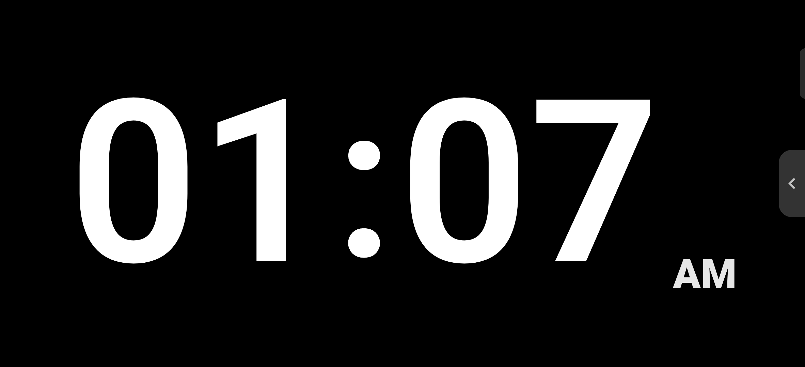
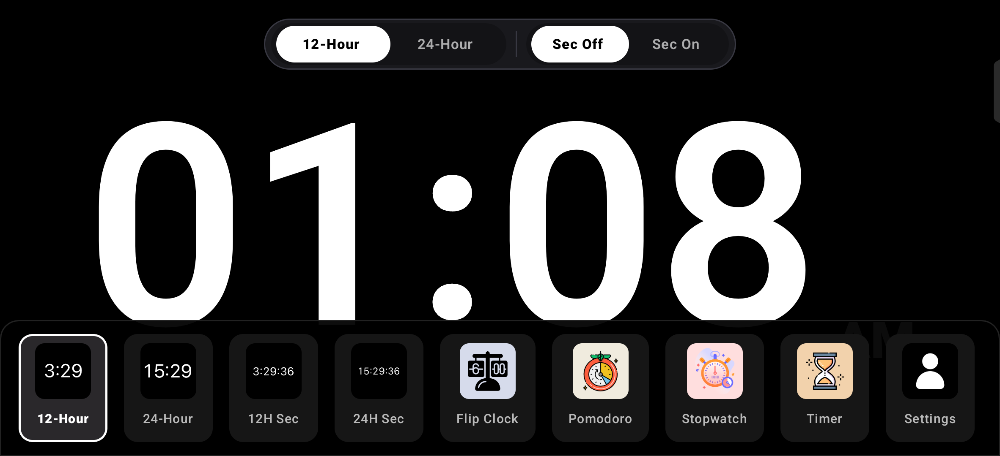
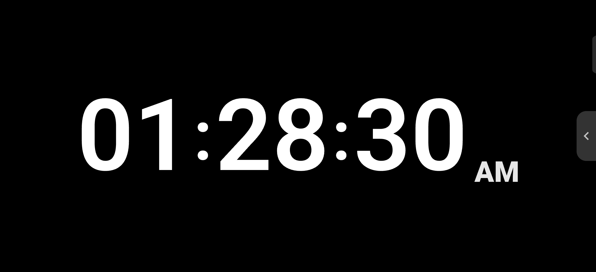
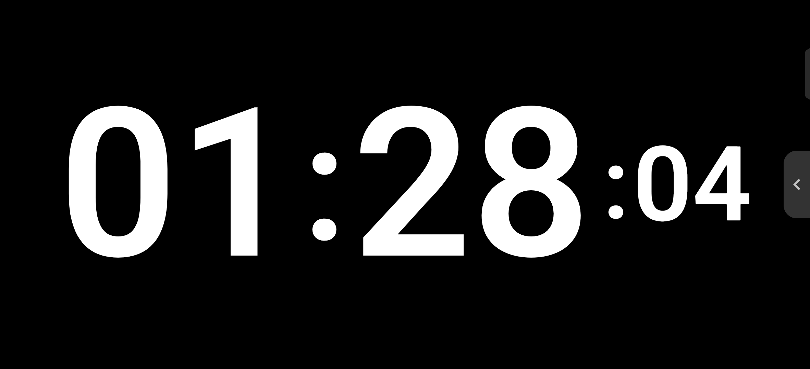
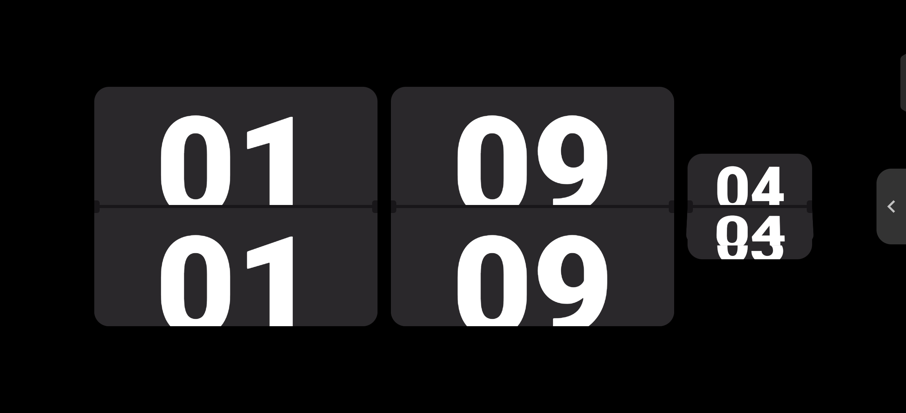

# Study Clock

[](https://kotlinlang.org)
[](https://developer.android.com/jetpack/compose)
[](https://m3.material.io/)
[](https://developer.android.com)
[](https://developer.android.com)
[](https://opensource.org/licenses/MIT)

**Study Clock** is a minimalist, distraction-free native Android clock and productivity application built with **Kotlin** and **Jetpack Compose**. Designed for study desks, bedside stands, and focused productivity sessions, it delivers an authentic, pure fullscreen experience with zero layout shift, seamless mode transitions, and responsive typography.

---

## Screenshots

| Pure Fullscreen Clock | Controls Overlay & Mode Drawer |
| :---: | :---: |
|  |  |

| 12-Hour Mode with Seconds | 24-Hour Mode with Seconds | Retro 3D Flip Clock |
| :---: | :---: | :---: |
|  |  |  |

---

## Key Features

### 1. Minimalist, Distraction-Free Digital Clock
- **Single-Screen Architecture:** Clock stays on a single screen at all times. Format (12H / 24H) and seconds toggles update in place with zero flickering or screen reloads.
- **Constant Typography:** Geometric typography derived from font cap-height ratios. Format switches preserve identical baseline positioning and font sizing.
- **Responsive Font Sizing:** Sizing models are derived from reference app physical measurements, with automatic cancellation of system `fontScale` to guarantee text never overflows or clips on devices with accessibility "Large Text" enabled.

### 2. Gesture Controls & Smart Auto-Hide
- **3-Second Inactivity Auto-Hide:** A single tap reveals the top format controls and bottom mode selector drawer. After 3 seconds of inactivity, controls smoothly slide away to restore a distraction-free pure black OLED display.
- **Side Drawer Handle:** Subtle curved handle on the right edge allows quick drawer opening without tapping the center clock.
- **Scroll & Touch Awareness:** Scrolling through modes or interacting with toggles dynamically resets the timer so controls never disappear while in use.

### 3. Comprehensive Productivity Suite (9 Modes)
1. **12-Hour Digital Clock:** Large digital clock with bottom-aligned AM/PM indicator.
2. **24-Hour Digital Clock:** Fullscreen military/international time format.
3. **12-Hour Seconds Clock:** Continuous top-of-the-second updates across all 6 digits (`HH : MM : SS`) with generous screen padding.
4. **24-Hour Seconds Clock:** Large `HH : MM` with subordinate smaller seconds to the right.
5. **Retro Mechanical Flip Clock:** Authentic 3D split-flap folding animation with center horizontal seam, hinge notches, and smooth perspective transformations.
6. **Pomodoro Timer:** 25-minute focus session timer on an eye-friendly warm peach background with session counter and audio/vibration completion alerts.
7. **Stopwatch:** Portrait timing with dual action controls (Start/Stop, Lap/Reset), millisecond precision, and a structured lap table distinguishing split from cumulative elapsed time.
8. **Countdown Timer:** Interactive circular progress ring with quick minute adjustments, state preservation, and background `AlarmManager` alerts.
9. **Settings:** Material 3 preferences screen with format toggles, Keep Screen On switch, and application metadata.

### 4. System & Hardware Integration
- **True Immersive Mode:** Fullscreen sticky immersive mode (`WindowInsetsControllerCompat.BEHAVIOR_SHOW_TRANSIENT_BARS_BY_SWIPE`) hides status and navigation bars.
- **Display Cutout Drawing:** Renders into camera cutouts and notches (`LAYOUT_IN_DISPLAY_CUTOUT_MODE_SHORT_EDGES`).
- **Screen Awake Management:** Window flag `FLAG_KEEP_SCREEN_ON` keeps the display on indefinitely when enabled.
- **Adaptive Launcher Icon:** Full vector adaptive launcher icons compliant with the 66dp safe zone and Material 3 design guidelines.

---

## Tech Stack & Architecture

- **Language:** Kotlin 2.0.21
- **UI Toolkit:** Jetpack Compose (BOM `2024.11.00`) + Material 3
- **Design Pattern:** MVVM (Model-View-ViewModel) with unidirectional data flow
- **State & Concurrency:** Kotlin Coroutines & `StateFlow` (`clockTickerFlow` aligned with wall-clock millisecond ticks)
- **Lifecycle:** `collectAsStateWithLifecycle` for lifecycle-aware UI composition
- **Notifications & Alarms:** `AlarmManager.setExactAndAllowWhileIdle()` and Android 13+ `POST_NOTIFICATIONS` runtime permissions
- **Build System:** Gradle 8.7.3 with Kotlin DSL (`build.gradle.kts`)

---

## Project Structure

```
study-clock/
├── app/
│   ├── src/main/
│   │   ├── AndroidManifest.xml
│   │   ├── java/com/ghost/fullscreenclock/
│   │   │   ├── MainActivity.kt               # Immersive window setup & lifecycle
│   │   │   ├── model/ClockMode.kt            # 9 supported clock & timer modes
│   │   │   ├── preferences/ClockPreferences.kt # SharedPreferences storage
│   │   │   ├── receiver/TimerAlertReceiver.kt # BroadcastReceiver for alarm alerts
│   │   │   ├── theme/                        # Color, Theme, & Type definitions
│   │   │   ├── time/                         # ClockTime ticker flows
│   │   │   └── ui/
│   │   │       ├── ClockApp.kt               # Root container & navigation orchestration
│   │   │       ├── components/               # DigitalClock, FlipCard, BottomModeDrawer, SideHandle
│   │   │       ├── screens/                  # DigitalClockScreen, FlipClockScreen, Pomodoro, etc.
│   │   │       └── viewmodel/TimersViewModel.kt # Shared state for timers, stopwatch & alerts
│   │   └── res/                              # Drawables, mipmaps, fonts, and strings
│   └── build.gradle.kts
├── docs/screenshots/                         # Application preview screenshots
├── .gitignore                                # Comprehensive Android & build ignores
├── LICENSE                                   # MIT License
└── README.md
```

---

## Getting Started

### Prerequisites
- **Android Studio:** Android Studio Ladybug (2024.2+) or newer
- **JDK:** Java Development Kit 21
- **Android SDK:** Compile SDK 36, Minimum SDK 24

### Building from Source

1. Clone the repository:
   ```bash
   git clone https://github.com/your-username/study-clock.git
   cd study-clock
   ```

2. Build the debug APK using the Gradle wrapper:
   - **Linux / macOS:**
     ```bash
     ./gradlew assembleDebug
     ```
   - **Windows:**
     ```powershell
     .\gradlew.bat assembleDebug
     ```

   The generated APK will be located at:
   `app/build/outputs/apk/debug/app-debug.apk`

3. Install on a connected physical device or emulator via ADB:
   ```bash
   adb install -r app/build/outputs/apk/debug/app-debug.apk
   ```

4. Launch the application:
   ```bash
   adb shell am start -n com.ghost.fullscreenclock/.MainActivity
   ```

---

## License

This project is licensed under the MIT License - see the [LICENSE](LICENSE) file for details.
